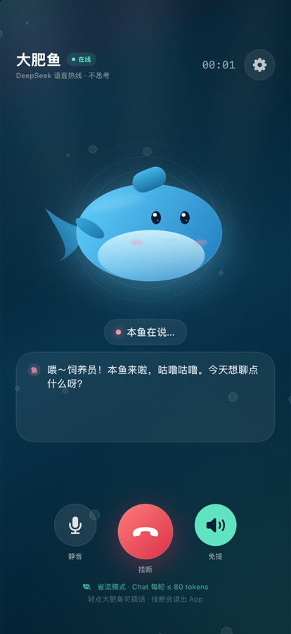
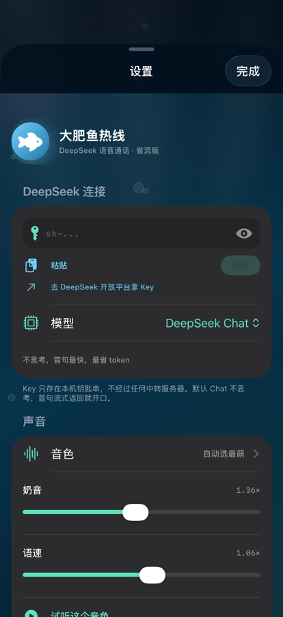
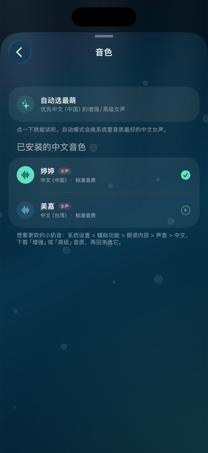
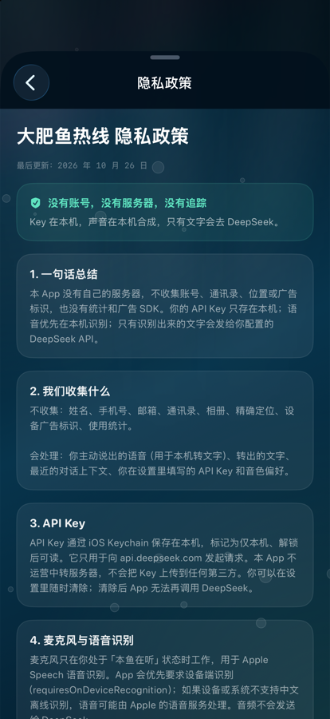

# 大肥鱼热线 · FatFishCall

一个用 SwiftUI 写的 iOS 语音通话 App：接通后直接说话，DeepSeek 大肥鱼会用本地合成的小奶音回你。挂断按钮会直接退出 App。

> 这是非官方粉丝作品，和 DeepSeek 官方无关。DeepSeek 名称归其权利人所有。

## 下载

- 安装包和更新：<https://github.com/duhaoze2007/dafeiyu_call_iOS/releases>
- 详细安装说明：[INSTALL.md](INSTALL.md)
- 源码仓库：<https://github.com/duhaoze2007/dafeiyu_call_iOS>




> 真实 iPhone 17 Pro 模拟器截图（iOS 26.3.1），已实际编译运行。截图里的 Key 是测试占位，仓库不包含任何 API Key。

## 编译与验证状态

当前开发机已经安装 **Xcode 27.1**，并且实际编译、运行过：

- `xcodebuild` 编译成功，产物为 `FatFishCall.app`；
- 安装到 iPhone 17 Pro 模拟器（iOS 26.3.1）并正常启动；
- 验证了语音识别 / 麦克风权限弹窗；
- 验证了设置页、Keychain 保存 / 清除 API Key；
- 验证了音色列表、选择音色、试听触发音频会话；
- 验证了隐私政策页面；
- 验证了红色挂断按钮会退出 App。

还没验证的部分：

- 真机麦克风 / 扬声器，以及真机上下载「婷婷（增强/高级）」后的实际音色；
- 真实 DeepSeek API 回复（没有真实 Key，只用占位 Key 走通了本地流程）；
- App Store 归档 / 上架审核。

> 模拟器构建不要加 `CODE_SIGNING_ALLOWED=NO`。实测关闭签名后 App 可以跑，但 Keychain 写入会失败；默认的 `Sign to Run Locally` 就够用。

## 功能

- **打电话式语音聊天**：启动即接通，大肥鱼先本地打招呼，然后自动进入聆听。
- **本地语音识别**：使用 Apple Speech，优先 `requiresOnDeviceRecognition`，音频不发给 DeepSeek。
- **本地小奶音 TTS**：使用 `AVSpeechSynthesizer`，默认音调 `1.36×`、语速 `0.53×`，优先选中文女声 / 婷婷 / 美嘉。
- **流式首句**：DeepSeek 返回第一个完整短句就开始念，不等全文。
- **省 token**：
  - 默认 `deepseek-chat`，不产生思考过程；
  - Chat 每轮最多 80 个输出 token；
  - 只带最近 6 条消息 / 560 个字符的上下文；
  - 问候、错误提示、短促的“嗯嗯”回应都在本地生成；
  - system prompt 固定且很短，方便命中上下文缓存。
- **电话感交互**：
  - 说话停顿约 1.0 秒自动结束这一轮；
  - 大肥鱼说话时轻点它，可以立即打断；
  - 静音 / 免提 / 挂断；
  - 挂断后 0.35 秒退出 App（`exit(0)`）。
- **完整设置页**：
  - DeepSeek API Key（Keychain 保存）；
  - 模型选择：`deepseek-chat`（默认，最快）/ `deepseek-reasoner`（会思考，更慢更费）；
  - 中文音色选择 + 逐个试听；
  - 奶音 / 语速滑杆；
  - 省流策略说明；
  - 关于本 App；
  - 完整隐私政策。
- **无第三方依赖**：纯 SwiftUI + AVFoundation + Speech + Security。





## 运行要求

- macOS 上安装 **Xcode 16 或更新版本**（本机实测 Xcode 27.1）；
- iOS **17.0+**；
- 一个 DeepSeek API Key；
- 真机最佳。模拟器也能打开界面，但麦克风 / 本地语音识别 / 系统音色不如真机稳定。

## 跑起来

1. 打开工程：

   ```bash
   open FatFishCall.xcodeproj
   ```

2. Xcode 左侧选 `FatFishCall` target → **Signing & Capabilities**：
   - 选自己的 Team；
   - 如果 Bundle ID 冲突，改成自己的，例如 `com.yourname.fatfishcall`。

3. 选一个 iPhone 模拟器或真机，点 Run。

4. 首次启动按顺序允许：
   - 语音识别；
   - 麦克风。

5. 设置页填入 DeepSeek API Key：
   - 获取地址：<https://platform.deepseek.com/api_keys>
   - Key 只存本机 Keychain，不经过任何中转服务器。

6. 想更软的小奶音，先去系统里下载增强音质：
   `设置 > 辅助功能 > 朗读内容 > 声音 > 中文` → 下载「婷婷（增强）」或「婷婷（高级）」。
   然后回到 App → 设置 → 音色 → 选婷婷。

## 设置页里有什么

- **DeepSeek 连接**
  - API Key 输入 / 显示 / 粘贴 / 更换 / 清除；
  - 模型：Chat（不思考，推荐）或 Reasoner（思考，慢且费）；
  - Reasoner 会显示明显变慢的警告。
- **声音**
  - 音色列表：自动选最萌、所有已安装中文音色；
  - 点一下音色就试听；
  - 奶音 1.10–1.65；
  - 语速 0.42–0.62；
  - 试听按钮。
- **省流策略**
  - Chat 每轮最多 80 tokens；
  - 最近 6 句上下文；
  - 本地 TTS / 本地问候。
- **关于**
  - 关于本 App；
  - 隐私政策；
  - 版本号；
  - 非官方声明。

## 它怎么省 token

| 位置 | 做法 |
|---|---|
| 输出 | `max_tokens = 80`（Chat） |
| 上下文 | 只发最近 6 条，单条最多 96 字，总计最多 560 字 |
| 长期历史 | 最多 8 条 / 900 字，超出从最旧的丢 |
| 问候 | 本地字符串 + 本地 TTS，不调用 API |
| 错误提示 | 本地字符串 + 本地 TTS，不调用 API |
| 短促回应 | “嗯 / 哦 / 好 / 哈哈”等直接本地接话，不调用 API |
| 人设 | 约 120 字固定 system prompt，稳定前缀利于缓存 |
| 语音识别 | Apple Speech，不消耗 DeepSeek token |
| 语音合成 | 本机 `AVSpeechSynthesizer`，不消耗 token |

默认 `deepseek-chat` 本身没有思考过程；只有你主动切到 `deepseek-reasoner` 才会先思考，电话里会明显变慢。

## 通话流程

```text
启动
  → 请求语音识别 / 麦克风权限
  → 本地播放问候
  → 聆听（停顿 1.0 秒自动结束）
  → 本地短回应，或发 DeepSeek
  → 流式返回
  → 按标点切句，第一句立即 TTS
  → 播完自动回到聆听
  → 轻点大肥鱼可打断
  → 红色挂断 = 退出 App
```

## 项目结构

```text
FatFishCall/
├── project.yml                         # XcodeGen 工程定义
├── FatFishCall.xcodeproj               # 已生成，可直接用 Xcode 打开
├── FatFishCall/
│   ├── App/FatFishCallApp.swift
│   ├── Models/
│   │   ├── AppConfig.swift             # 模型、Token 上限、本地文案
│   │   ├── ChatMessage.swift
│   │   ├── SentenceChunker.swift       # 流式分句
│   │   └── TokenBudget.swift           # 人设 prompt / 历史裁剪 / 朗读清洗
│   ├── Services/
│   │   ├── AudioSession.swift
│   │   ├── DeepSeekClient.swift        # SSE 流式请求
│   │   ├── KeychainStore.swift
│   │   ├── SpeechInput.swift           # Apple Speech 识别
│   │   ├── SpeechOutput.swift          # 小奶音 TTS 队列
│   │   └── VoiceConfig.swift           # 音色 / 音调 / 语速
│   ├── ViewModels/CallEngine.swift     # 通话状态机
│   ├── Views/
│   │   ├── CallView.swift              # 通话主界面
│   │   ├── FatFishView.swift           # SwiftUI 手绘大肥鱼
│   │   ├── SettingsView.swift          # 设置
│   │   ├── VoicePickerView.swift       # 音色选择
│   │   ├── AboutView.swift             # 关于 + 隐私政策
│   │   └── Theme.swift                 # 配色 / 海浪 / 气泡
│   ├── Resources/
│   │   ├── Assets.xcassets             # AppIcon / AccentColor / LaunchBackground
│   │   └── PrivacyInfo.xcprivacy
│   └── Info.plist
├── Scripts/make_icon.py                # 重新生成 1024 图标
├── INSTALL.md                          # 模拟器 / iPhone 安装说明
├── LICENSE                             # MIT
└── README.md
```

## 修改工程

工程由 [XcodeGen](https://github.com/yonaskolb/XcodeGen) 生成。改 `project.yml` 后：

```bash
xcodegen generate
```

重新生成图标（需要 Pillow）：

```bash
python3 Scripts/make_icon.py
```

## 隐私（和 App 内隐私政策一致）

- 没有账号、没有自建服务器、没有统计 SDK、没有广告；
- API Key 只存 iOS Keychain（仅本机、解锁后可读）；
- 麦克风只用于 Apple Speech 转文字，音频不会发给 DeepSeek；
- 优先设备端识别；设备不支持中文离线识别时，可能由 Apple 的语音服务处理；
- 只有识别出的文字 + 固定人设 + 最近几条上下文会通过 HTTPS 发给 `api.deepseek.com`；
- 对话历史只在内存里，App 退出即清空；
- 音色 / 音调 / 语速 / 模型选择存在 UserDefaults；
- 不要在通话里说身份证、银行卡、密码等敏感信息。

完整文本在 App 内：设置 → 隐私政策。



## 已知限制 / 注意事项

1. **挂断即退出 App** 是按要求用 `exit(0)` 实现的。App Store 审核通常不接受这种主动退出行为；如果要上架，把 `AppConfig.exitOnHangup` 改成 `false`，App 会显示“通话结束 / 再拨一次”界面。
2. 已经在模拟器编译运行过，但还没有真机测试；真机上的麦克风、扬声器和增强音色仍建议实际试一遍。
3. Reasoner 会明显变慢，且 300 token 的预算仍可能被思考过程吃掉；电话场景建议保持 Chat。
4. 增强 / 高级中文音色需要用户自己去系统设置下载。没有下载时，App 会自动退回已安装的默认中文女声。
5. Xcode 27 的模拟器窗口在 `Device Hub.app` 里；模拟器音频输入要允许使用 Mac 麦克风。本地中文语音识别在模拟器上可能不可用，建议真机测试。
6. 首次运行必须填 API Key，App 不带任何内置 Key，也没有离线大脑。
7. 目前没有开启后台音频：切到后台或锁屏时，这一轮通话会暂停；回到前台点一下大肥鱼继续。

## 常见问题

**没有声音？**
- 看主界面右下角是“免提”还是“听筒”；
- 检查系统音量；
- 设置 → 声音 → 试听；
- 下载增强中文音色后再选一次。

**一直“没听清”？**
- 确认麦克风 / 语音识别权限；
- 真机测试；
- 模拟器换用 Mac 麦克风输入；
- 说话停顿 1.0 秒会结束这一轮，不要停太久。

**API 报错？**
- 401 / 403：Key 不对或没权限；
- 402：余额不足；
- 429：限流；
- 其他：看主界面错误提示，或换网络。

**为什么回复很短？**
这是故意的：电话场景 + 省 token。人设 prompt 要求每次 1–2 句、最多 40 个汉字，Chat 输出上限 80 token。

## 验证记录

本机实际执行过的命令：

```bash
./Scripts/run_core_checks.sh

xcodebuild \
  -project FatFishCall.xcodeproj \
  -scheme FatFishCall \
  -configuration Debug \
  -destination 'platform=iOS Simulator,name=iPhone 17 Pro' \
  -derivedDataPath .build/DerivedData \
  build

xcrun simctl install booted .build/DerivedData/Build/Products/Debug-iphonesimulator/FatFishCall.app
xcrun simctl launch booted com.duhaoze.fatfishcall
```

结果：

- `BUILD SUCCEEDED`；
- 源码没有编译警告（只有 `appintentsmetadataprocessor` 的“未使用 AppIntents”无害提示）；
- 模拟器里权限弹窗、设置、Keychain、音色、隐私政策、挂断退出都正常。

唯一没有继续做的是真机音频测试和真实 DeepSeek 请求。前者需要一台 iPhone，后者需要你的 API Key。

## License

MIT License，见 [LICENSE](LICENSE)。
